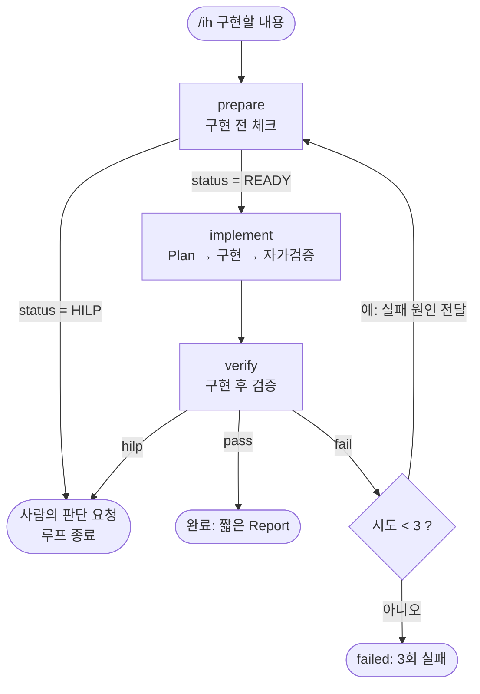

# ih (Implement Harness) 루프 설계

`/ih <구현할 내용>` 으로 실행하는 **구현 검증 루프**다. 구현을 한 번에 던지지 않고
**prepare(구현 전 체크) → implement(구현) → verify(구현 후 검증)** 세 단계로 나누고,
검증이 실패하면 그 실패 원인을 들고 prepare 로 돌아가며, 사람의 판단이 필요하면 구현 없이 멈춘다.

| 항목 | 내용 |
|---|---|
| 실행 | `/ih <구현할 내용>` (Claude Code Dynamic Workflow) |
| 워크플로 | `.claude/workflows/ih.js` |
| 서브에이전트 | `.claude/agents/prepare.md`, `implement.md`, `verify.md` |
| 증거 | `docs/evidence/권웅기/{TASK-xxx-taskname}/precheck.html`, `report.html` |
| 최대 시도 | 3회 (`MAX_ITERATIONS`, 첫 시도 포함) |

> 에이전트와 워크플로 정의는 `/reload-skills` 때 다시 읽힌다. 수정한 뒤에는 반드시 리로드하고 실행한다.

---

## 1. 전체 흐름



- **Feedback Loop**: verify 가 fail 이면 `failures`(문제·근거·제안)를 다음 prepare 로 넘긴다. prepare 는 "이번에는 이 문제를 해결하기 위한 구현 전 체크"로 동작하고, implement 는 이전 시도의 변경이 남은 작업 트리에서 이어서 고친다.
- **Human-in-the-loop (HILP)**: prepare 또는 verify 가 HILP 를 반환하면 루프가 즉시 종료되고 이유와 질문이 사용자에게 전달된다. 사용자가 답한 뒤 `/ih` 를 다시 실행한다.
- **증거 폴더 재사용**: 첫 회차에서 정해진 작업 번호(`TASK-006` 등)와 폴더를 재진입 때 그대로 쓴다. 새 폴더를 만들지 않고 같은 HTML 에 회차 이력을 쌓는다.

## 2. 단계별 역할

### 2-1. prepare — 구현 전 체크 (코드를 구현하지 않는다)
구현을 시작해도 되는지, 끝났을 때 무엇으로 합격을 판단할지를 정한다.

1. **배경·목적 이해 점검**: 상황(배경)과 이유(목적)를 내 말로 설명할 수 있는가. 못 하면 HILP.
2. **변경 규모·위험 점검**: 규모(작음~매우 큼)와 위험 심각도(낮음~높음), 사용자가 그 위험을 아는지.
3. **저장소 상태**: 현재 브랜치, base 브랜치, 공용 브랜치 여부, 미커밋 변경.
4. **원격 동기화**: `git fetch` 후 원격과 비교. 원격이 앞서고 작업 트리가 깨끗하며 fast-forward 가능할 때만 `git pull --ff-only`. 그 밖에는 기록만 한다(merge·rebase·reset·stash·push 금지).
5. **baseline 테스트**: 구현 전 상태에서 보유한 테스트를 전부 실행해 "N건 중 M건 성공"을 기록한다. 구현 후 비교 기준이 된다.
6. **영향도 분석**: 직접 수정 대상, 호출·참조하는 곳, 화면·API, 기존 테스트, 데이터.
7. **요청 종류 판단과 종류별 점검**(§3).
8. **구현 후 체크리스트 3개**: 목적 달성을 가르는 항목을 정확히 3개. 확인 방법은 하나로 확정하고, 합격 기준은 숫자·문자열·상태로 쓰며, 적어도 하나는 요청한 결과를 직접 관찰하는 항목으로 정한다.
9. `precheck.html` 작성.

**HILP 조건**: 배경 미이해 / 목적 미이해 / 큰 규모·높은 위험을 사용자가 모름 / 미커밋 변경이 대상 파일과 겹치는데 사용자가 모름 / 원격 동기화 실패 + 원격 변경이 대상과 겹치는데 사용자가 모름 / 요청 종류에 따라 방향이 갈림.

### 2-2. implement — 구현
Plan 작성 → 구현 → 자가검증. prepare 의 전제·주의사항, 체크리스트 3개, 영향도, 저장소 상태(이미 있던 미커밋 변경은 건드리지 않음)를 받는다. 자가검증에서 `pass` 는 **마지막 변경 이후 실제로 실행한 것**에만 쓴다. 커밋·push·PR 은 하지 않는다.

### 2-3. verify — 구현 후 검증 (implement 의 자가검증을 믿지 않는다)
1. precheck.html 존재 확인(없으면 fail)
2. 체크리스트 3개를 **직접 실행해** 확인 (직접 관찰한 근거만 합격. 빌드 성공·diff 읽기만으로는 `unverified`)
3. 수용 기준 확인 (요청의 목적·범위에서 뽑은 합격 조건. 범위를 넘은 변경이 있으면 실패)
4. 종류별 확인(§3)
5. 회귀 테스트 **전체** 실행 (JUnit, E2E)
6. 정적 점검 (저장소에 설정된 lint·포매터·컴파일 경고만. 없으면 `not-configured`, 실패 아님)
7. 변경한 동작을 직접 단언하는 테스트 확인, 없으면 작성 (테스트 파일만 수정)
8. 영역 판정 Green/Yellow/Red
9. 판정 pass / fail / hilp, `report.html` 작성

**판정**

| 판정 | 조건 | 다음 |
|---|---|---|
| pass | 체크리스트·수용 기준·종류별 확인·회귀·정적 점검 모두 통과 | 루프 종료, 짧은 Report |
| fail | 하나라도 실패 | prepare 로 복귀 |
| hilp | 실행 환경 부재 등 사람이 정할 일 | 루프 종료 |

verify 는 프로덕션 코드를 고치지 않는다. 문제를 찾으면 고치지 않고 fail 로 돌려보낸다.

## 3. 요청 종류별 분기

prepare 가 요청을 **기능 추가(feature) / 리팩터링(refactor) / 버그 수정(bugfix)** 중 하나로 판단(`task_type`)하고, 종류별로 prepare 점검과 verify 확인이 달라진다. 섞여 있으면 주된 종류를 고르고 범위를 좁힌다.

| | 기능 추가 | 리팩터링 | 버그 수정 |
|---|---|---|---|
| 판단 | 동작을 추가하거나 의도적으로 바꿈 | 외부 동작은 그대로, 내부 개선 | 기대와 다르게 동작하는 결함을 고침 |
| **prepare 점검** | 요구사항 근거 · 기존 기능과의 충돌 · 인수 조건 | 보호할 동작 · 변경 영역을 덮는 기존 테스트 · 동작 변경 없음 | **재현**(절차·기대·실제) · 원인 가설 · 수정 범위 |
| **prepare HILP** | 인수 조건을 못 정함 | 동작 변경이 섞여 분리 필요 | 재현·원인 모두 불명, 의도된 동작인지 불명 |
| **verify 확인** | 인수 조건 충족 · 기존 기능 유지 · 요구사항과 충돌 없음 | 외부 동작 불변 · 기존 테스트 미변경 · baseline 과 동일 결과 · 동작 변경 없음 | 결함 재현 안 됨(수정 후 같은 절차 재실행) · 회귀 테스트 · 수정 범위 최소 · 인접 동작 유지 |
| **테스트 면제** | 불가 | 가능(기존 테스트가 덮어야 함) | 불가 |

## 4. 안전장치 (verify 의 pass 를 워크플로가 다시 검사한다)

에이전트의 판정을 그대로 믿지 않는다. `verify` 가 pass 로 답해도 `verdictOf` 가 아래에 해당하면 **fail 로 바로잡아** prepare 로 돌려보낸다.

- 체크리스트가 3개가 아니거나 하나라도 pass 가 아님
- 수용 기준 · 종류별 확인(`type_verification`) 에 `passed: false`
- 회귀 테스트 실패·미실행, 정적 점검 실패·미실행
- baseline 보다 성공 건수가 줄어듦 (리팩터링은 전체 건수가 줄어도)
- 기능 추가·버그 수정에서 테스트 면제(`exempt`)
- `test_coverage.detail`(직접 확인한 근거)이 비어 있음

그 밖의 보호 장치:
- **증거 재작성**: prepare 가 `precheck.html` 을 쓰지 못하면(`evidence_bytes` 가 0) 한 번 다시 요청하고, 그래도 없으면 오류로 끝낸다. verify 의 `report.html` 이 없으면 경고를 남긴다.
- **구조화 출력 오류 재요청**: 에이전트의 JSON 출력이 깨지면 한 번 다시 요청한다. 깨짐의 주원인(큰따옴표·역슬래시·줄바꿈)을 프롬프트에서 미리 금지한다.
- **경고 로그**: 공용 브랜치 작업, 미커밋 변경, 원격 미동기화, baseline 에서 이미 실패하는 테스트.
- **빈 입력·에이전트 오류·null 응답**은 `status: error` 로 끝낸다.

## 5. 데이터 흐름 (구조화 출력)

단계 사이의 값은 스키마가 있는 구조화 출력으로 주고받는다.

```
prepare  ──▶ status, task_id/evidence_path, background, purpose, risk,
             repo_state(branch, base_branch, dirty…), task_type, type_checks, repro,
             sync, baseline, impact, check_status, constraints, checklist[3]
                │
                ▼ (constraints · checklist · impact · repo_state · task_type 전달)
implement ─▶ status, summary, plan, changed_files, verification, assumptions, open_issues
                │
                ▼ (+ baseline · repro 전달)
verify   ──▶ result(pass/fail/hilp), next_step, checklist_results, criteria,
             task_type, type_verification, regression, static_checks, test_coverage,
             triage(영역 판정), changed_files, not_run, remaining_issues, next_action,
             failures, stage_summary, evidence_path, report
```

- verify 가 fail 이면 `failures`(+ 워크플로가 보정한 실패)가 다음 회차의 prepare·implement 프롬프트에 들어간다.
- 최종 결과(`status`): `pass` / `hilp` / `failed`(3회 실패) / `error`.

## 6. 증거 HTML

사람이 읽는 증거다. 한 파일로 완결(인라인 CSS, 외부 자원 없음)되고 라이트/다크·모바일·인쇄를 지원한다.

**precheck.html** (prepare)
점검 상태(6개 칩) → 요청 원문 → 이해 점검 → 저장소·원격 동기화(현재/base 브랜치, 처리 내용) → baseline 테스트(N건 중 M건) → 변경 규모와 영향도 → 유형별 점검(+재현 정보) → 체크리스트 3개 → 확인한 근거 → (재진입 시) 회차 이력. 헤더에 READY/HILP 배지와 작업 유형 배지.

**report.html** (verify)
영역 판정(Green/Yellow/Red: 기준·이유·신호·해야 할 작업) → 한눈에 보는 요약 → 테스트 결과(체크리스트·수용 기준·유형별 확인·Regression Test·실행하지 못한 검증·정적 점검·테스트 커버리지·변경한 파일) → 결론(요청·남은 이슈·다음에 할 일·점검 페이지 링크) → 확인한 근거. 헤더에 PASS/FAIL/HILP 배지와 작업 유형 배지. fail·hilp 면 헤더 아래에 알림 섹션.

영역 판정(Green/Yellow/Red)은 PASS/FAIL/HILP 와 **별개**다. 바뀐 영역의 성격과 테스트가 충분한지를 보여 주어 사람이 이후 검토에 얼마나 힘을 쏟을지 알려준다.

## 7. 설계 결정과 이유

| 결정 | 이유 |
|---|---|
| 구현과 검증 에이전트 분리 | 구현한 쪽의 자가검증을 그대로 믿지 않기 위해. verify 가 직접 다시 실행한다 |
| 체크리스트를 구현 **전에** 확정 | 구현 결과를 보고 기준을 맞추는 것을 막는다. 합격 기준을 사전에 고정한다 |
| 직접 관찰한 근거만 합격 | 빌드 성공·diff 읽기는 목적 달성을 보여 주지 못한다 |
| baseline 을 구현 전에 측정 | 원래 실패하던 테스트와 이번 변경으로 깨진 테스트를 구분한다 |
| verify 는 프로덕션 코드를 수정하지 않음 | 검증자가 문제를 조용히 고치면 문제가 기록되지 않는다 |
| 워크플로의 판정 보정 | 에이전트가 pass 로 잘못 답해도 증거 기준으로 걸러낸다 |
| 원격 동기화는 fast-forward 만 | 오래된 코드 위에 구현하지 않되, 사용자의 작업을 건드리지 않는다 |
| E2E 는 전용 인메모리 DB·8091 포트 | 개발 DB 와 사용자의 8080 앱을 건드리지 않는다 |
| 최대 3회 | 같은 실패를 무한히 반복하지 않는다 |

## 8. 실행 환경 전제

- **JUnit**: 저장소 루트에서 `./gradlew.bat test`
- **E2E (Playwright)**: 저장소 루트에 `package.json`, `package-lock.json`, `playwright.config.ts` 가 있어야 한다. 이 파일들은 `.gitignore` 로 커밋에서 제외되어 있어 각자 로컬에 둔다. 없으면 baseline·verify 가 E2E 를 `not-run` 으로 적고, verify 는 사람이 정할 일로 보아 HILP 를 낸다. 필요하면 `npm ci`, `npx playwright install chromium`.
- 점검 중 사용자의 8080 앱과 개발 DB 는 건드리지 않는다.

## 9. 검증 이력

- **목 테스트**(워크플로 로직, 20개 시나리오): 정상 통과, 실패 후 prepare 복귀, HILP 종료, 3회 실패, 빈 입력·에이전트 오류, 판정 보정, 증거 재작성, 종류별 분기, 구조화 출력 오류 재요청 등.
- **실제 실행**: 로그인 부제 문구 변경 시험 요청으로 `/ih` 를 여러 번 실행했다.
  - 정상 경로: 1회차 pass (JUnit 22/22, E2E 46/46)
  - HILP 경로: 큰 변경(마이크로서비스·DB 이전)을 사용자가 모르는 채 요청 → prepare 가 구현 없이 종료
  - 발견·수정한 문제: precheck 증거 미작성, 캐시된 옛 워크플로 실행, 구조화 출력 JSON 깨짐, E2E 환경 파일 부재

## 10. 한계와 남은 일

- 요청 종류 분류는 에이전트의 판단이다. 문구·정책 변경처럼 경계가 모호한 요청은 기능 추가로 분류되어 테스트 면제가 되지 않는다.
- 리팩터링·버그 수정 경로는 실제 `/ih` 로 아직 시험하지 않았다(목 테스트로만 검증).
- 영역 판정(Green/Yellow/Red)의 기준은 초안이다.
- E2E 간헐 실패(STS-05)처럼 원인이 불명인 flaky 테스트는 baseline 에 기록만 하고 판정에서 허용한다.
- 미적용 아이디어: implement 의 범위 밖 변경 보고(`unplanned_changes`), 반복 실패 시 HILP 로 승격, 최대 시도 횟수를 인자로 받기.
