# /im Loop — 구현 요청을 4단계와 피드백 루프로 처리하기

`/im <구현할 내용>` 한 번으로 **준비 → 구현 → 테스트 → 리팩토링**을 서브에이전트 4개가 차례로 수행하고, 문제가 생기면 **준비 단계로 돌아가** 다시 시도하는 Loop입니다. 사람의 판단이 필요한 순간에는 Loop가 멈추고 사람에게 질문을 넘깁니다.

## 한눈에 보기

```mermaid
flowchart TD
  A([/im 구현할 내용]) --> P[prepare]
  P -- "status = HILP" --> H([종료: 사람에게 질문])
  P -- "status = READY" --> I[implement]
  I -- "completed = false" --> X([종료: 구현 미완료])
  I --> T[test]
  T -- "FAIL" --> P
  T -- "BLOCKED" --> B([종료: 환경 문제, 사람에게 넘김])
  T -- "PASS" --> R[refactoring]
  R -- "FAIL" --> P
  R -- "DONE" --> E([종료: Loop 완료])
```



| 순서 | 에이전트 | 한 줄 역할 |
|---|---|---|
| 1 | `prepare` | 배경·목적을 이해했는지 확인하고, 사전 점검 보고서와 Plan(체크리스트)을 만든다 |
| 2 | `implement` | prepare가 이해한 내용과 Plan대로 구현하고, 자가검증 후 PRD 문서를 갱신한다 |
| 3 | `test` | 체크리스트와 보유한 모든 테스트를 확인하고, 새 기능의 Unit Test를 만든다 |
| 4 | `refactoring` | 개선 제안 3가지를 점검해 보고서에 적는다 (코드는 수정하지 않는다) |

## 사용법

```
/im 주문 목록에 검색 기능 추가
```

- 인자는 **구현할 내용** 하나입니다. 비어 있으면 안내 메시지를 돌려주고 끝납니다.
- 정의 파일: 워크플로우 `.claude/workflows/im.js`, 에이전트 `.claude/agents/{prepare,implement,test,refactoring}.md`
- `.claude/`는 팀 `.gitignore`에 들어 있어 git에 추적되지 않습니다. 팀과 공유하려면 별도로 올려야 합니다.

## 단계별 설명

### 1. prepare — 구현 전에 멈출지 판단한다
구현하지 않고 **이해 확인 → 사전 점검 → 위험 판단 → 보고서(영향도 분석 포함) → Plan** 순서로 진행합니다.

- **이해 확인:** 사용자의 **배경**(어떤 상황인가)과 **목적**(왜 필요한가)을 이해했는지 확인합니다. 둘 중 하나라도 확신이 서지 않으면 추측하지 않고 `HILP`를 반환합니다.
- **사전 점검:** 현재 브랜치, base, 원격 동기화, baseline 테스트(구현 전 상태), `docs/understand/김도현/prd_implement.md`와 요청이 달라지는 부분을 확인합니다.
- **위험 판단:** 너무 큰 변경이거나 심각도 높은 Risk가 있는데 사용자가 모르는 것 같으면 경고하면서 `HILP`를 반환합니다.
- **영향도 분석:** 보고서에 직접·간접 영향, 영역별(화면·서비스·계산 로직·DB·테스트) 영향도, 영향받을 기존 테스트, INTENT 확인, 종합 등급(낮음·중간·높음)을 적습니다. 코드를 읽고 검색한 결과이며 추정은 "추정"으로 표시합니다.
- **산출물:** `docs/evidence/김도현/TASK-NNN-prepare/precheck.html` (짧은 사전 점검 보고서, NNN은 아래 "TASK 번호 규칙" 참고)
- **Plan:** 목표, 변경 대상, 단계, 하지 않을 것, 위험, **검증 체크리스트**. 체크리스트는 test가 항목별로 PASS/FAIL을 판정하므로 확인 가능한 한 문장으로 씁니다.
- 소스 코드는 수정하지 않습니다. 쓰는 파일은 보고서 하나뿐입니다.

### 2. implement — 이해한 내용대로 구현한다
- prepare의 **배경·목적과 Plan**을 기준으로 구현합니다. 방향을 다시 추측하지 않습니다.
- 구현 후 **자가검증**(빌드, 관련 테스트, diff 범위, PRD·INTENT 대조)을 실제로 실행해서 확인합니다.
- 끝나면 `docs/understand/김도현/prd_implement.md`에서 **이번에 반영된 부분만** 갱신합니다. 원본 `docs/PRD.md`는 수정하지 않고, 구현해서 확인한 동작만 반영합니다.
- 커밋·푸시·PR 생성은 하지 않습니다.

### 3. test — 독립적으로 검증한다
- prepare의 **체크리스트를 항목별로** 확인합니다.
- 보유한 **Regression · Unit · E2E 테스트를 모두** 실행합니다.
- 새 기능에 대한 **Unit Test를 만들어** 실행하고, 기능이 의도적으로 바뀌어 기존 테스트가 달라져야 하면 테스트를 만들거나 고쳐서 실행합니다.
- **프로덕션 코드는 수정하지 않습니다.** 결함은 고치지 않고 FAIL로 보고합니다.
- **PASS**이면 `docs/evidence/김도현/TASK-NNN/report.html`을 씁니다. 보고서는 `.claude/templates/report-template.html` 양식을 따르며, 템플릿은 그대로 두고 JSON 데이터만 채웁니다. 내용은 **영역 판정(Green·Yellow·Red)**, 테스트 결과(체크리스트, Regression·Unit·E2E 건수, **추가·변경된 테스트**), 결론입니다.
- **영역 판정:** 팀 기준으로 정합니다. Green은 테스트가 충분하고 위험이 낮은 영역, Yellow는 품질이 고르지 않거나 기존 테스트를 완전히 믿기 어려운 영역, Red는 인증·결제·권한·급여 등 민감하거나 도메인 지식이 필요한 영역입니다. 두 영역에 걸치면 높은 쪽으로 판정합니다.
- FAIL이면 문제별 `kind`, 실패 근거, 해결 힌트를 담아 prepare로 돌아갑니다.

### 4. refactoring — 개선 3가지를 점검하고 제안만 한다
- 이번 변경 범위를 중심으로 개선이 필요한 부분을 찾아 **제안 3가지**를 점검(효과·위험·검증 가능성)합니다.
- **코드는 수정하지 않습니다.** 리팩토링을 실제로 수행하지 않고 제안만 하므로 `selected`는 항상 비어 있습니다.
- test가 쓴 같은 `report.html`의 JSON에 `refactoring` 키(요약, 제안 목록, 점검한 파일)를 **추가**합니다. 기존 값은 바꾸지 않으며, 템플릿이 "리팩토링 제안 (코드 수정 없음)" 카드로 보여 줍니다. 이어 쓴 뒤 `DONE`을 반환합니다. (Loop 종료)
- 점검 중 **리팩토링으로는 해결할 수 없는 결함**(요구사항과 어긋난 동작 등)을 발견하면 `FAIL`로 prepare로 돌아갑니다.

## Loop 규칙

### 되돌아가는 조건 (Feedback Loop)
| 어디서 | 조건 | 가는 곳 | 함께 넘기는 것 |
|---|---|---|---|
| test | `status = FAIL` | prepare | 실패 목록(`kind`, `description`, `evidence`, `fix_hint`) |
| refactoring | `status = FAIL` | prepare | 문제 목록(`description`, `evidence`, `fix_hint`) |

돌아간 prepare는 **전달된 실패를 해결하는 것**을 이번 Plan의 목적으로 삼습니다. 다시 시도하는 라운드는 **새 TASK 번호**를 받습니다 (아래 "TASK 번호 규칙" 참고).

### 끝나는 조건
| 종료 상태 | 의미 |
|---|---|
| `done` | refactoring이 `DONE`을 반환했다 (정상 완료) |
| `needs_human` | prepare가 `HILP`를 반환했다 (Human-in-the-loop) |
| `test_blocked` | test가 환경 문제로 일부 테스트를 실행하지 못했다 |
| `implement_incomplete` | implement가 구현을 끝내지 못했다 |
| `max_rounds_exceeded` | 3회까지 prepare로 되돌아갔지만 해결하지 못했다 |
| `agent_error` | 에이전트가 실행되지 않았거나 결과가 없거나 형식이 맞지 않다 |
| `error` | 인자(구현할 내용)가 비어 있다 |

### Human-in-the-loop (HILP)
prepare가 `HILP`를 반환하는 경우는 세 가지입니다.
1. **배경 이해 부족**
2. **목적 이해 부족**
3. **큰 변경 또는 높은 Risk를 사용자가 모르는 것 같을 때** (경고와 함께)

이때 Loop는 종료되고, 결과에 `hilp.reasons`, `hilp.warnings`, `hilp.questions`가 담겨 사용자가 바로 답할 수 있습니다. 답한 뒤 `/im`을 다시 실행합니다. 요청에 사용자가 규모나 위험을 알고 있다고 분명히 적혀 있으면 멈추지 않고 경고만 보고서에 남깁니다.

### 설계 결정 (추가로 정한 것)
요청 스펙에 더해 아래를 정해 구현했습니다.
- **최대 3회:** prepare로 돌아갈 수 있는 횟수의 상한입니다. 무한 루프를 막으려고 두었습니다 (`im.js`의 `MAX_ROUNDS`).
- **`BLOCKED`:** 앱을 띄울 수 없거나 설정 파일이 없어 E2E를 못 돌리면 PASS도 FAIL도 판단할 수 없으므로, prepare로 돌아가지 않고 사람에게 넘기고 종료합니다.
- **refactoring 제안이 3개 미만이면** 억지로 채우지 않고 찾은 만큼만 적으며, 개선할 부분이 없으면 제안 없이 `DONE`입니다.
- **refactoring은 코드를 고치지 않습니다.** 제안만 하므로 되돌릴 변경이 없고, 테스트도 다시 실행하지 않아도 됩니다.

## 단계 사이의 약속 (반환 값)
각 에이전트는 아래 형식으로 결과를 돌려줍니다. 필드 이름은 워크플로우가 읽으므로 바꾸지 않습니다.

| 에이전트 | 상태 값 | 주요 필드 |
|---|---|---|
| prepare | `READY` / `HILP` | `task_id`, `understanding`, `hilp`, `precheck`, `plan` |
| implement | `completed` true/false | `changed_files`, `deviations`, `self_check`, `prd_update` |
| test | `PASS` / `FAIL` / `BLOCKED` | `checklist`, `executed`, `tests_added`, `tests_modified`, `failures`, `report_path` |
| refactoring | `DONE` / `FAIL` | `proposals`(`selected`는 모두 false), `verification`, `issues`, `report_path` (`selected`는 항상 비움) |

## 산출물 위치
| 파일 | 만드는 단계 |
|---|---|
| `docs/evidence/김도현/TASK-NNN-prepare/precheck.html` | prepare |
| `docs/understand/김도현/prd_implement.md` (갱신) | implement |
| `docs/evidence/김도현/TASK-NNN/report.html` | test가 작성, refactoring이 이어서 작성 |

`report.html`은 `.claude/templates/report-template.html`로 만듭니다. test가 템플릿을 복사해 `/*__TRIAGE_DATA__*/null` 자리에 보고서 JSON(`triage`, `verify` 등)을 넣고, refactoring은 그 JSON에 `refactoring` 키만 추가합니다. 템플릿의 HTML·CSS·스크립트는 고치지 않습니다. 템플릿은 `.claude/` 안에 있어 git에 추적되지 않습니다.

### TASK 번호 규칙
보고서 경로는 **고정하지 않습니다.** 한 라운드가 시작될 때마다(`/im`을 새로 실행할 때, 또는 실패로 prepare로 돌아가 다시 시도할 때) 새 TASK 번호를 받아 그 폴더에 씁니다.

- **위치:** `docs/evidence/김도현/` 아래
- **번호 정하기:** 이 폴더 안의 기존 `TASK-NNN`(`TASK-NNN-prepare` 포함) 중 **가장 큰 번호 + 1**로 새 폴더를 만듭니다. 세 자리로 씁니다.
  - 예) `TASK-001`이 있으면 이번에는 `TASK-002`
  - 하나도 없으면 `TASK-001`부터 시작합니다.
- **새 폴더 이름:** 사전 점검은 `TASK-NNN-prepare/precheck.html`, 테스트·리팩토링 보고서는 `TASK-NNN/report.html`입니다.
- **번호는 prepare가 정해서 전달합니다.** 라운드가 시작될 때 prepare가 폴더를 읽어 번호를 정하고 `task_id`로 반환하면, 워크플로우가 같은 라운드의 test와 refactoring에 그 번호를 넘깁니다. test와 refactoring은 번호를 직접 정하지 않습니다.
- **한 번의 Loop 실행(한 라운드: prepare → implement → test → refactoring)은 같은 TASK 번호를 씁니다.** test가 쓴 `report.html`에 refactoring이 이어서 써야 하므로 둘이 같은 폴더를 가리켜야 하기 때문입니다.
- **다시 시도하는 라운드는 새 TASK 번호를 만듭니다.** test나 refactoring이 실패해 prepare로 되돌아가면, 그 라운드는 위 규칙대로 **가장 큰 번호 + 1**의 새 폴더에 씁니다. 이전 라운드의 폴더는 그대로 남아 실패 증빙이 됩니다.
  - 예) 첫 라운드가 `TASK-002`에서 test 실패 → 다시 시도하는 라운드는 `TASK-003`
  - `/im`을 새로 실행할 때도 마찬가지로 가장 큰 번호 + 1입니다.
- 이미 있는 `TASK-NNN` 폴더는 지우거나 덮어쓰지 않습니다. 이전 실행의 증빙이 남도록 합니다.

## 일관되게 지키는 원칙
- **실행한 것과 추정한 것을 구분합니다.** 보고에는 "실행해서 확인 / 코드를 읽고 추정 / 확인하지 못함"을 나눠 적습니다.
- **변경은 작게.** 요청 범위를 벗어난 정리, 이름 변경, 포맷 변경을 하지 않습니다. 팀 프로젝트의 공용 파일은 꼭 필요할 때만 건드립니다.
- **커밋·푸시·PR 생성은 에이전트가 하지 않습니다.**
- **역할을 섞지 않습니다.** prepare는 코드를 고치지 않고, test는 프로덕션 코드를 고치지 않고, refactoring은 코드를 고치지 않습니다.

## 검증 현황과 한계
- **확인한 것:** 워크플로우의 문법과 제어 흐름을 가짜 에이전트 응답으로 시험했습니다. 한 번에 완료, test 실패 후 복귀, refactoring 실패 후 복귀, HILP 종료, 최대 횟수 초과, BLOCKED 종료, implement 미완료, Plan 없는 READY 오류, 인자 없음의 9가지 경로가 의도대로 동작했고, 복귀할 때 실패 내용이 prepare에 전달되는 것도 확인했습니다.
- **확인하지 못한 것:**
  - E2E는 앱이 떠 있고 Playwright 설정 파일이 있어야 실행됩니다. 이 설정은 현재 저장소(`main`)에 없어 `BLOCKED`가 나올 수 있습니다.
- **알려진 한계:**
  - **TASK 번호 부여는 실제 폴더를 읽는 에이전트(prepare)에 맡겨져 있습니다.** 워크플로우는 돌려받은 번호가 `TASK-001` 형식인지만 검사하고, 그 번호가 실제로 가장 큰 번호 + 1인지는 검사하지 않습니다. 가짜 응답 시험에서는 번호 전달만 확인했고, 실제 폴더 목록을 읽어 번호를 정하는 동작은 확인하지 못했습니다.
  - 최대 3회 상한은 상수라 인자로 바꿀 수 없습니다.
