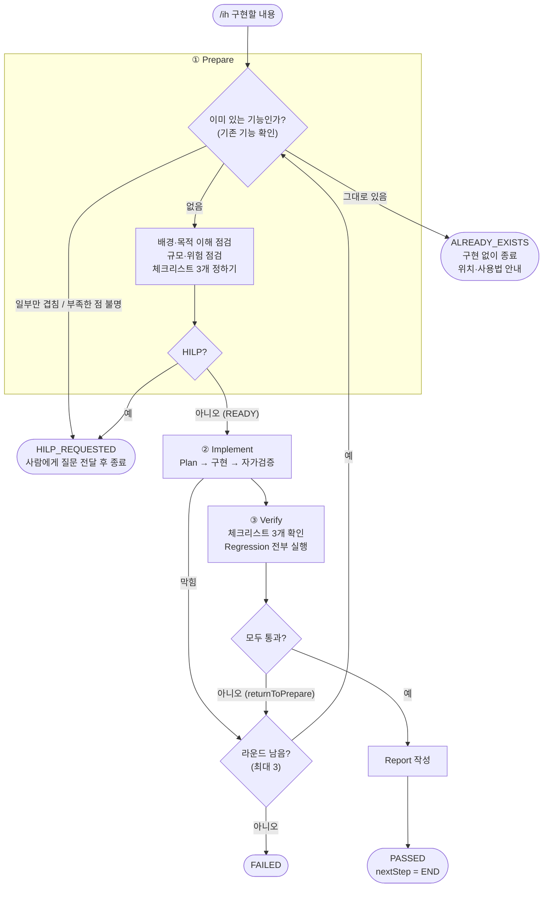

# ih 루프 (Implement Harness) 설계

> 작성: 김재연
> **`/ih <구현할 내용>` 은 구현부터 하지 않는다. 먼저 "이미 있는 기능인가?"를 확인한다.**
> 요청한 기능이 이미 그대로 있으면 **구현하지 않고 바로 끝내고**(`ALREADY_EXISTS`), 없을 때만 구현 → 검증으로 간다.
> 검증이 실패하면 그 문제를 들고 다시 준비 단계로 되돌아가는 구현 루프다.

## 핵심: 이 루프는 "기존 기능 확인"으로 시작한다

기능 추가 요청의 가장 흔한 낭비는 **이미 있는 기능을 또 만드는 것**이다. 그래서 루프의 첫 관문(Prepare 의 1번 일)을 기존 기능 확인으로 정했다.

| 확인 결과 | 상태 | 루프는 |
|---|---|---|
| 요청한 기능이 **그대로** 있다 | `ALREADY_EXISTS` | **구현하지 않고 종료**. 있는 곳(코드·화면·API·테스트)과 사용법을 알려 준다 |
| **일부만** 겹친다 / 무엇이 부족해서 요청했는지 알 수 없다 | `HILP` | 종료하고 사람에게 구체적인 질문을 전달한다 |
| 없다 | (계속) | 배경·목적, 규모·위험을 점검하고 구현으로 간다. 찾은 재사용 가능한 것은 구현 단계가 이어서 쓴다 |

"그대로 있다"는 세 가지가 모두 맞을 때만 인정한다.
1. 요청이 말한 동작을 기존 기능이 **이미 한다**.
2. 그 **위치**(코드, 화면, API, 테스트)를 댈 수 있다.
3. 요청에 "부족하다", "개선", "바꿔", "고쳐" 같은 말이 없다. (있으면 새 기능이 아니라 변경 요청이다)

**잘못된 "이미 있음"을 막는 장치**
- **커밋된 코드에 있어야 한다.** 찾은 코드가 아직 커밋되지 않은 변경 안에만 있으면(앞선 실행이 만든, 검증되지 않은 구현일 수 있다) 기존 기능으로 확정하지 않는다.
- **라운드 1 에서만 인정한다.** 라운드 2 이후에는 직전 라운드가 만든 구현이 작업 트리에 있으니, 그것을 "이미 있다"로 오인하지 않도록 인정하지 않는다.
- **위치를 대지 못하면 인정하지 않는다.** 근거 없는 "있는 것 같다"는 HILP 로 처리한다. 하네스가 이를 한 번 더 확인한다.

예

| 요청 | 결과 |
|---|---|
| "주문을 조회하는 기능을 추가해줘" | **실제로 실행해 봄**: 목록·상세 조회가 이미 있는데 무엇이 부족한지 알 수 없어 `HILP_REQUESTED` (A 검색 / B JSON API / C 취소 이력 / D 기존 화면 개선 중 무엇인지 질문) |
| "id로 주문을 조회하는 기능" | `GET /orders/{id}` 상세 화면이 이미 있으므로 `ALREADY_EXISTS` 로 끝나도록 설계했다 (실제 에이전트로는 아직 확인 전) |
| "주문 목록에 고객사 열을 추가한다" | 없음 → 계속 진행 |

## 한눈에 보기



- **세 단계**는 각각 별도의 서브에이전트(`prepare`, `implement`, `verify`)가 맡는다.
- **되돌아가기**: 검증이 실패하거나 구현이 막히면 그 내용을 들고 다음 라운드의 준비 단계로 간다. 최대 3라운드.
- **일찍 끝나는 길이 두 개**: 이미 있으면 `ALREADY_EXISTS`, 사람의 판단이 필요하면 `HILP_REQUESTED`. 둘 다 구현을 시작하지 않는다.

## 왜 이렇게 만들었나

| 문제 | 설계 |
|---|---|
| **이미 있는 기능을 또 만든다** | 구현 **전에** 코드에서 기존 기능을 먼저 찾고, 그대로 있으면 구현 없이 `ALREADY_EXISTS` 로 종료 |
| 요청을 오해한 채 구현을 시작하면 통째로 다시 해야 한다 | 배경과 목적을 이해했는지 점검하고, 이해하지 못했으면 HILP |
| 사용자가 모르는 큰 변경·위험이 조용히 진행될 수 있다 | 변경 규모와 위험을 점검하고, "사용자가 모르는 것으로 보이면" 경고와 함께 HILP |
| "끝났다"의 기준이 사람마다 다르다 | 구현 후 반드시 확인할 **체크리스트 3개**를 먼저 정해 둔다 |
| 구현한 쪽의 자가검증은 믿기 어렵다 | 검증은 **다른 에이전트가 직접 실행**하고, 하네스가 결과를 한 번 더 판정 |
| 새 기능이 기존 기능을 깨뜨린다 | 보유한 Regression Test(Gradle 테스트 + E2E)를 **전부** 실행 |
| 실패하면 같은 곳을 맴돈다 | 실패 이유와 다시 볼 곳(`returnToPrepare`)을 준비 단계로 돌려보내 **원인부터 다시** 정리 |
| 무엇을 했는지 나중에 알기 어렵다 | 단계마다 로그와 HTML 기록을 남기고, 통과하면 짧은 보고서를 만든다 |

## 구성 요소

| 파일 | 역할 |
|---|---|
| `.claude/workflows/ih.js` | 워크플로 본체. 단계 순서, 되돌아가기, 종료 조건, 결과 재판정 |
| `.claude/agents/prepare.md` | 준비 에이전트의 역할과 절차 (**기존 기능 확인 포함**) |
| `.claude/agents/implement.md` | 구현 에이전트의 역할과 절차 |
| `.claude/agents/verify.md` | 검증 에이전트의 역할과 절차 |
| `.claude/scripts/precheck/` | 점검 페이지(`precheck_*.html`)를 만드는 스크립트와 템플릿 |
| `.claude/scripts/report/` | 보고서(`report_*.html`)를 만드는 스크립트와 템플릿 |

> `.claude/` 는 `.gitignore` 대상이라 **이 PC에만** 있고 저장소에는 올라가지 않는다. 이 README 는 그 파일들을 설명하는 문서다.

## 단계별 역할

### ① Prepare — 이미 있는지 확인하고, 시작해도 되는지 판단하고, 끝의 기준을 정한다
1. **기존 기능 확인 (가장 먼저)**: 요청의 핵심 단어로 코드를 찾아 비슷한 기능·화면·API·테스트가 이미 있는지 본다. 결과를 "재사용 가능 / 무관"으로 기록한다. 위 "핵심" 표대로 `ALREADY_EXISTS`, `HILP`, 계속 중 하나로 갈린다.
2. **배경(어떤 상황인가)** 과 **목적(왜 필요한가)** 을 이해했는지 점검한다. 내 말로 요약하고 근거(요청, 문서, 코드)를 댈 수 있어야 "이해함"이다.
3. **변경 규모**(작음~매우 큼)와 **위험**(낮음~높음)을 점검하고, 각각 요청한 사람이 알고 있는지 판단한다.
4. 구현이 끝난 뒤 확인할 **중요 체크리스트 3개**(제목, 확인 방법, 중요한 이유)를 정한다.
5. 점검 내용을 로그와 HTML 로 남긴다. 소스 코드는 수정하지 않는다.

**HILP 를 반환하는 경우**
1. 같은 기능이 일부만 겹치거나, 무엇이 부족해서 요청했는지 알 수 없다.
2. 배경이나 목적을 이해하지 못했다.
3. 변경이 너무 거대한데(`매우 큼`) 사용자가 모르는 것으로 보인다. (경고 포함)
4. 심각도 `높음` 위험이 있는데 사용자가 모르는 것으로 보인다. (경고 포함)

사용자가 알고 감수하겠다고 한 경우에는 HILP 가 아니라 경고만 기록하고 진행한다. 습관적으로 HILP 를 내지 않고, 사소한 모호함은 가정으로 적고 진행한다.

### ② Implement — Plan 을 세우고 구현하고 스스로 검증한다
- 순서: 목적 파악 → 읽기 → **Plan** → 구현 → 테스트 → **자가검증**.
- 준비 단계가 찾은 **재사용 가능한 기존 기능**을 이어서 쓴다. 수용 기준과 체크리스트 3개를 만족하는 **가장 작은 변경**을 만들고, 범위 밖 변경은 하지 않는다.
- `docs/INTENT.md` 의 불변식(확정 주문 불변, 서버 재계산, 수거량 = 주문량 등)을 깨야만 해결되거나 요구가 모호하면 **막힘(blocked)** 으로 돌려준다. 추측으로 밀어붙이지 않는다.
- 커밋, 푸시, PR 은 하지 않는다.

### ③ Verify — 직접 실행해서 판정한다
1. **변경 확인**: `git diff` 로 실제 변경이 보고와 같은지, 범위 밖 변경이 없는지 본다.
2. **체크리스트 3개**: 준비 단계가 정한 "확인 방법"을 그대로 실행해 하나씩 판정한다. 근거 없이 통과로 하지 않는다.
3. **Regression Test 전부 실행**
   - Gradle 테스트(`./gradlew.bat test`)
   - Playwright E2E 전체. 실행 중인 서버(8080)의 DB 는 쓰지 않고, **별도 DB 의 임시 서버(8081)** 를 띄워서 돌린 뒤 반드시 종료한다.
4. **판정**: 체크리스트, 수용 기준, Regression 이 모두 통과해야 PASS. 실행하지 못한 것은 PASS 가 아니다.
5. **기록**: 통과·실패 모두 검증 로그를 남긴다. PASS 이면 짧은 Report 와 HTML 보고서를 만든다.

## 되돌아가기 (피드백 루프)

| 상황 | 돌려주는 값 | 다음 |
|---|---|---|
| 검증 실패 | `nextStep: PREPARE` + `returnToPrepare`(이유, 해결할 문제, 다시 볼 곳), 실패 목록, 실패한 Regression, 검증 로그 경로 | 다음 라운드의 Prepare |
| 구현 막힘 | 막힌 이유 | 다음 라운드의 Prepare |

- 되돌아간 준비 단계는 **직전 실패를 코드에서 직접 확인**하고 범위·수용 기준·체크리스트를 다시 정리한다. (이때는 방금 만든 구현을 "기존 기능"으로 오인하지 않도록 `ALREADY_EXISTS` 판정을 하지 않는다.)
- 요구 자체가 모호하거나 불변식을 깨야 해결되는 문제처럼 **사람이 판단할 일**이면, 코드를 더 고치게 하지 않고 HILP 로 끝낸다.
- 라운드는 기본 최대 **3회**다(`{"task": "...", "maxRounds": N}` 형태로 1~5까지 지정 가능).

## 루프가 끝나는 경우

| 상태 | 언제 | 다음 행동 |
|---|---|---|
| `ALREADY_EXISTS` | **요청한 기능이 이미 그대로 있음** (구현하지 않음) | 알려 준 위치와 사용법으로 기존 기능을 쓴다. 부족한 점이 있으면 구체적으로 적어 `/ih` 다시 실행 |
| `PASSED` | 검증 통과. Report 작성 후 `nextStep = END` | 보고서 확인 |
| `HILP_REQUESTED` | prepare 가 사람의 확인이 필요하다고 판단 | 경고·질문에 답한 뒤 `/ih` 다시 실행 |
| `FAILED` | 최대 라운드 안에 검증을 통과하지 못함 | 마지막 실패(`lastFeedback`)와 라운드 이력 확인. 작업 트리에는 마지막 구현이 남는다 |
| `ABORTED` | 에이전트가 결과를 돌려주지 않음 | 중단된 단계부터 확인 |
| `PREPARE_INCOMPLETE` | 목적·수용 기준·체크리스트 3개가 부족하거나, 라운드 2 이후에 `ALREADY_EXISTS` 가 나옴 | 요청을 구체화해 다시 실행 |
| `ARGS_ERROR` | 구현할 내용을 주지 않음 | `/ih 구현할 내용` 형태로 실행 |

## 에이전트의 말을 그대로 믿지 않는다

하네스(`ih.js`)는 에이전트가 돌려준 값을 한 번 더 판정한다.

- **기존 기능 확인**: `ALREADY_EXISTS` 라고 해도 위치(`locations`)가 없으면 인정하지 않고 HILP 로 처리한다. 라운드 2 이후의 `ALREADY_EXISTS` 는 인정하지 않는다.
- **준비 단계**: `status` 가 READY 라도 배경·목적을 이해하지 못했다고 쓰여 있거나, `매우 큼`/`높음` 인데 사용자가 모른다고 쓰여 있으면 HILP 로 바꾼다. 체크리스트가 정확히 3개가 아니면 구현으로 넘기지 않는다.
- **검증 단계**: `status` 가 PASS 라도 체크리스트 3개와 수용 기준 중 하나라도 미통과이거나, Regression 결과가 없거나 실패가 있거나, `failures` 가 남아 있으면 FAIL 로 처리한다.
- 보고서 빌더는 **통과한 건만** 만든다. 체크리스트나 Regression 에 실패가 있으면 만들기를 거절한다.

## 남기는 기록

실행할 때마다 **새 파일**로 남기고, 기존 파일은 덮어쓰거나 고치지 않는다. 한 실행의 로그와 HTML 은 같은 시각(`날짜_시간_초`)을 쓴다. `ALREADY_EXISTS`·`HILP` 로 일찍 끝난 실행도 점검 기록은 남는다.

| 단계 | 파일 | 위치 |
|---|---|---|
| Prepare | 점검 로그 (기존 기능 확인 결과 포함) | `docs/logs/prepare/inspection_{날짜_시간_초}.log` |
| Prepare | 점검 페이지 (이미 있는 기능이면 위치·사용법 표시) | `docs/evidence/김재연/precheck_{날짜_시간_초}.html` |
| Verify | 검증 로그 (통과·실패 모두) | `docs/logs/verify/review_{날짜_시간_초}.log` |
| Verify | 구현 보고서 (통과했을 때만) | `docs/evidence/김재연/report_{날짜_시간_초}.html` |

HTML 은 에이전트가 직접 쓰지 않는다. 점검 한 건의 JSON 을 스크립트(`build-precheck.cjs`, `build-report.cjs`)에 넘기면 고정 템플릿으로 만들어, 모양이 항상 같고 데이터 안의 문자열이 페이지를 깨뜨리지 않는다. `ALREADY_EXISTS` 점검 기록은 위치가 없으면 만들어지지 않는다.

## 사용법

```
/ih 주문 목록에 고객사 열을 추가한다
```

실행 전에 필요한 것
- 저장소 루트에 Playwright 설정 파일(`package.json`, `playwright.config.ts`)과 `node_modules`. 저장소에 올라가지 않고 이 PC에만 있다. 없으면 검증이 E2E 를 돌리지 못해 환경 문제로 실패한다.
- Java 17, Node.js. (Gradle 은 `gradlew.bat` 을 쓴다.)

## 설계 판단과 주의

- **먼저 있는지 본다.** 만드는 비용보다 찾아보는 비용이 훨씬 싸다. 그래서 기능 추가 요청이면 구현 전에 기존 기능부터 확인한다.
- **검증은 구현과 분리한다.** 같은 에이전트가 만들고 검증하면 놓친 것을 같이 놓친다.
- **기준을 먼저 정한다.** 체크리스트 3개를 구현 전에 정해 두면 구현이 "통과하기 쉬운 쪽"으로 기울지 않는다.
- **무한 반복을 막는다.** 라운드 상한과 HILP 가 있어, 풀 수 없는 문제는 사람에게 넘어간다.
- **공유 DB 를 건드리지 않는다.** 주문 확정은 삭제 수단이 없어서, 쓰기가 있는 E2E 는 임시 서버와 임시 DB 에서만 돌린다.
- **소스를 고치는 것은 구현 단계뿐이다.** 준비와 검증은 `docs/logs/`, `docs/evidence/` 의 새 파일만 쓴다. (이 제한은 도구로 막은 것이 아니라 에이전트 지침으로 정한 것이다.)
- 기존 기능 확인은 `Grep`/`Glob` 으로 찾는 방식이라, **이름이 전혀 다른 구현은 놓칠 수 있다.** 그래서 "그대로 있다"는 위치 근거가 있을 때만 인정하고, 애매하면 HILP 로 묻는다.
- 라운드마다 Gradle 테스트와 E2E 를 모두 돌리므로 **시간이 걸린다**(처음 확인했을 때 Gradle 약 40초, 임시 서버 기동과 E2E 약 1분).
- 알려진 결함을 `test.fail()` 로 표시한 테스트(예: 주문 취소)는 실패가 예상대로 나면 통과로 센다.

## 검증 현황

**해 본 것**
- **실제 에이전트로 `/ih` 실행 1회**: "주문을 조회하는 기능을 추가해줘" → 준비 단계가 기존 조회 기능(`GET /orders`, `GET /orders/{id}`, 화면, 테스트)을 찾아 `HILP_REQUESTED` 로 종료했다. 구현은 시작하지 않았고, 점검 로그와 점검 페이지가 정해진 형식으로 남았다.
- 워크플로 흐름: 가짜 에이전트로 시나리오 18개(통과, 재시도, HILP, 구현 막힘, 모든 라운드 실패, 에이전트 응답 없음, 에이전트가 틀린 PASS 를 낸 경우, **`ALREADY_EXISTS` 종료·위치 없음·라운드 2 에서의 오인·우선순위** 등)를 확인했다.
- 검증이 쓰는 명령: `./gradlew.bat test` 결과 집계, 임시 서버(8081) 기동 → E2E 전체 → 서버 종료를 이 PC에서 실제로 실행해 확인했다.
- 점검 페이지·보고서 빌더: 정상 생성, 잘못된 입력 거절, 덮어쓰기 거절, 화면 렌더링을 확인했다. (`ALREADY_EXISTS` 점검 페이지 포함)

**아직 못 한 것**
- 실제 에이전트로 `ALREADY_EXISTS` 판정이 나오는지는 확인 전이다(예: "id로 주문을 조회하는 기능").
- Implement 와 Verify 를 실제 에이전트로 끝까지 실행해 보지 않았다(임시 서버 기동, E2E 실행, 보고서 생성). 구현이 필요한 작은 요청으로 첫 실행을 해 보는 것을 권한다.

## 앞으로

- **버그 수정용 루프**: 재현 확인(준비)과 증상 가리기 탐지(검증)를 추가한 변형. 새 워크플로(`/bf`)로 만들고 같은 에이전트에 버그 모드 지침을 얹는 방식을 생각하고 있다.
- **기능 추가용 강화**: 수용 기준을 "시나리오와 확인할 테스트"로 확정하고, 검증에서 기준마다 새 테스트가 있는지 대조.
- **기존 기능 확인의 정확도**: 검색어 외에 `docs/PRD.md` 의 요구사항 번호와 기존 E2E 시나리오 이름도 함께 대조.
- 점검·보고서 기록을 한곳에서 모아 보는 목록 페이지.
