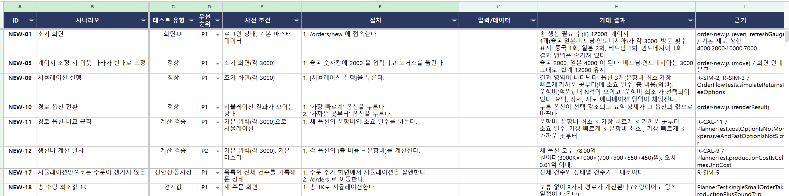

# 1. 테스트 세팅

<!-- 세팅한 테스트의 종류별 개수와 테스트 도구를 적으세요. 세팅하지 않은 테스트는 개수에 0을 적거나 행을 지우세요. -->

| 테스트 | 개수 | 테스트 도구 |
|---|:-:|---|
| Unit Test | 20개 | JUnit 5 (`PlannerTest` 19, `OrderStatusTest` 1) |
| Slice Test | 0개 | - |
| 통합 테스트 | 46개 | Spring Boot Test + MockMvc (`OrderFlowTests` 37, `DueDaysTest` 8, `DemoApplicationTests` 1) |
| E2E 테스트 | 67개 | Playwright (chromium, 14개 spec 파일) |
| Robustness 테스트 | 0개 | - |
| Stress 테스트 | 2개 plan | Apache JMeter (단계별 부하, 동시성 경합) |
| 성능 테스트 | 1개 plan | Apache JMeter (기준선) |
| Test Coverage | 91.7% | JaCoCo (Java 테스트 기준 라인 커버리지, 브랜치 89.9%) |

 

## 테스트 시나리오

<!-- 아래 샘플 이미지를 팀이 제작한 테스트 시나리오 캡처로 교체하세요. 캡처는 presentation/assets/에 올리고 파일명을 맞추세요. -->

---

[← 목차](README.md) · [다음: Loop 설계 →](02-loop.md)
