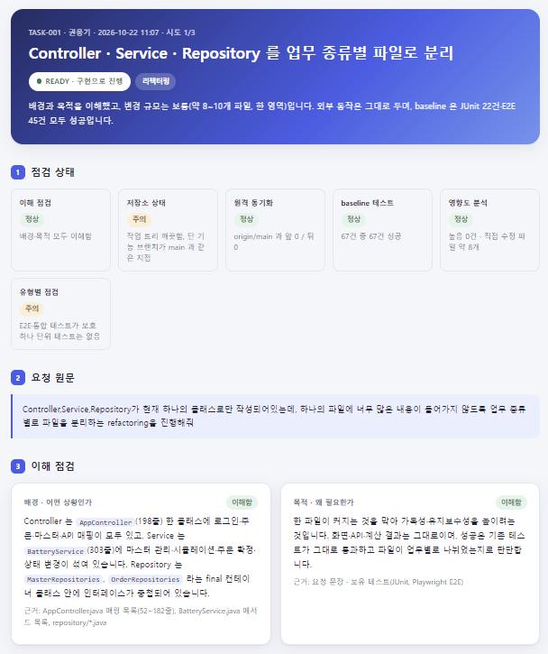
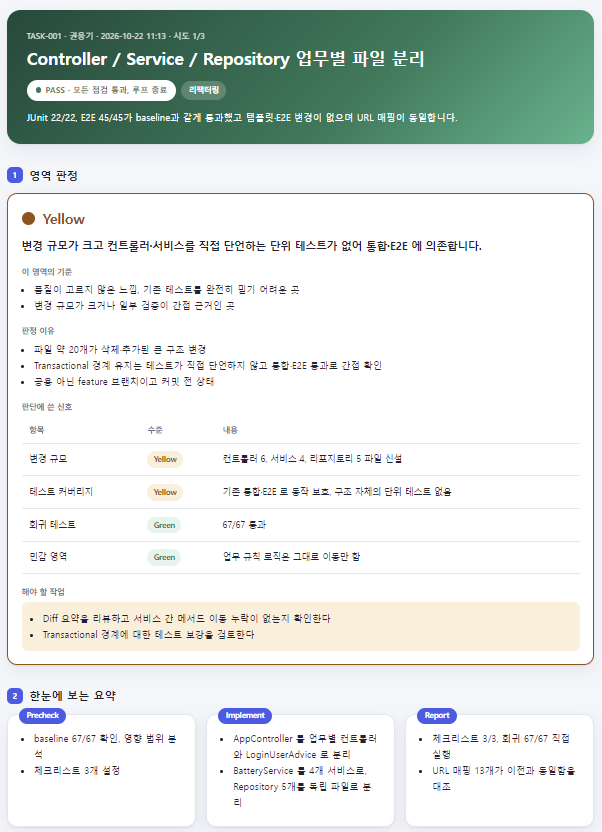

# 2. Loop 설계

Loop 설계는 이번 팀 프로젝트에서 가장 핵심이 되는 내용입니다.

이번 프로젝트에서는 구현 전에 점검하고, 구현 후에는 검증하여 리포트를 작성하는 자신만의 Loop를 각자 설계했습니다.

이 중 소개할 만한 좋은 Loop를 선정하여 소개합니다.

 

## 팀 Evidence 템플릿

<!-- 팀에서 협의한 Evidence 템플릿 2개를 소개하세요. -->
<!-- GitHub에서는 .html 파일이 화면으로 렌더링되지 않고 소스로 보입니다. 결과 화면을 캡처해서 presentation/assets/에 올리고 함께 보여주세요. -->
<!-- precheck.html, report.html 파일 위치가 루트가 아니면 링크 경로를 고치세요. -->

| 템플릿 | 사용 시점 | 링크 |
|---|---|---|
| precheck.html | 구현 전 | [precheck.html](../docs/evidence/권웅기/TASK-001-split-controller-service-repository/precheck.html) |
| report.html | 구현 후 | [report.html](../docs/evidence/권웅기/TASK-001-split-controller-service-repository/report.html) |

### - precheck 예시

### - report 예시

 

## Best Practice: Loop 설계

팀 프로젝트 중 각자 자신만의 Loop를 소개한 Markdown 페이지를 업로드했습니다. (경로 : `docs/loops/팀원이름/README.md`)

이 중 괜찮다고 생각이 드는 Best Practice Loop를 소개합니다.

<!-- Best Practice를 2개 정도 소개하세요. 소개 팀원, Loop 설명 링크, 좋았던 점 3가지만 적습니다. -->

#### Best Practice 1

| 항목 | 내용 |
|---|---|
| 소개 팀원 | 김준영 |
| Loop 설명 링크 | [README.md](../docs/loops/김준영/README.md) |
| 좋았던 점 | 1. 테스트를 쓰는 AI와 구현하는 AI를 분리했습니다. 테스트 작성 AI는 구현 코드를 보지 못하고 계약서(spec)만 보고 테스트를 씁니다. 그래서 테스트가 구현에 맞춰지는 것을 막을 수 있습니다. 2. "됐다"는 판정을 AI가 아니라 스크립트가 합니다. 합격 여부는 종료 코드로 정하고, 근거 없는 PASS는 인정하지 않습니다. 구현 전에 테스트가 실제로 실패하는지도 스크립트가 확인해서, 처음부터 항상 통과하는 가짜 테스트를 걸러냅니다. 3. 사람이 확인하는 지점이 분명합니다. 계약서와 작업 분해 두 곳에서 사람이 승인해야 다음 단계로 넘어갑니다. 계약이 틀리면 이후 작업이 모두 낭비되기 때문에, 가장 비용이 적은 시점에 확인하는 구조입니다. 4. 실패해도 무한히 반복하지 않습니다. 같은 실패가 두 번 연속 나오면 진전이 없다고 판단해 멈추고, 증거를 handoff.md에 남겨 사람이 이어서 판단할 수 있습니다. |

#### Best Practice 2

| 항목 | 내용 |
|---|---|
| 소개 팀원 | 김재연 |
| Loop 설명 링크 | [README.md](../docs/loops/김재연/README.md) |
| 좋았던 점 | 1. 낭비를 구현 전에 막습니다. 첫 관문이 기존 기능 확인입니다. 요청한 기능이 이미 있으면 구현 없이 ALREADY_EXISTS로 끝내고 위치와 사용법을 알려 줍니다. 2. 오판을 막는 장치가 구체적입니다. 아래 세 가지를 모두 만족해야 "이미 있음"으로 인정합니다.   - 커밋된 코드에 있을 것   - 1라운드에서만 판정할 것   - 위치를 댈 수 있을 것 3. 에이전트의 말을 그대로 믿지 않습니다. 하네스가 결과를 다시 판정합니다. 위치 없는 ALREADY_EXISTS는 HILP로 바꾸고, PASS여도 Regression이 없거나 실패가 있으면 FAIL로 처리합니다. 판정과 테스트 결과가 어긋나면 보고서 빌더가 생성을 거절합니다.  |

 

## Loop를 돌리며 느꼈던 점

팀원들 중 Loop를 돌리며 겪은 시행착오가 있다면 공유해 주세요.

Loop를 돌리면서 좋았던 점과 아쉬웠던 점, 그리고 문제가 발생해서 개선했던 점을 적어 주세요.

#### 좋았던 점

| 이름 | 좋았던 점 |
| --- | --- |
| 권웅기 | 원격 동기화와 저장소 상태를 자동으로 점검하는 루틴을 넣음으로써 prepare가 원격이 앞선 것을 보고 fast-forward로 가져와서 오래된 코드 위에서 구현하지 않았습니다. |
| 김도현 | LOOP 를 직접 설계해보고 필요한 정보들을 evidence 로 확인할수 있는 부분이 좋았습니다.  사전 점검 단계에 영향도 분석을 포함시켜서 추가되는 기능의 영향도를 직관적으로 알수 있었습니다.   verify 단계에서는 리팩토링 제안을 포함시켜서 추후에 고려해볼수 있는 리팩토링 사항들을 알수 있어서 좋았습니다. |
| 김재연 | 기능을 추가할때마다 반복적으로 수행해야 하는 작업을 루프에 넣음으로써 불필요한 시간 소요를 줄이고, 기능 개발에만 집중할 수 있게 되어 좋았습니다. |
| 김준영 | 심플한 agent로도 충분히 효과적인 결과를 낼 수 있다는 점이 좋았습니다. (planner, slicer, test-writer, implementer, verifier만 두고 통과 여부는 스크립트가 판정) 혼자 쓸 때는 토큰 절약을 위해 md 파일로만 결과를 받았는데, HTML 리포트로 보니 훨씬 직관적이었습니다. 작은 과제여서 그럴 수 있지만, 과도한 workflow보다 심플한 workflow도 효과적이라는 것을 경험했습니다. |

#### 아쉬웠던 점

| 이름 | 아쉬웠던 점 |
| --- | --- |
| 권웅기 | 작은 변경에도 오래걸릴 때가 있었습니다. 이 부분은 loop를 최적화하거나 작업구분별 loop를 따로 만들어야 할 것 같습니다. |
| 김도현 | LOOP 가 한번에 성공하지 못하거나 한번 수행만으로도 오래 걸렸던 부분들이 있었습니다. LOOP 가 실제로 현업에서 적용되고 있는 경우의 사례들을 직접 접하고 시행착오에 대한 해결에 대해서도 들을 수있는 기회가 있었으면 좋았겠다고 생각을 하게 되었습니다. |
| 김재연 | 기존 기능을 확인하는 부분이 이름 검색에만 의존하는 등 구체적이지 못해서 아쉬웠습니다. |
| 김준영 | AI가 용어를 축약해서 쓰는 부분이 리포트를 읽을 때 직관적이지 않았습니다. (AC, CON, IMPACT-TEST, red 게이트 등. red 게이트는 신호등의 RED와도 헷갈림) 그래서 기준, 제약, 영향테스트, 실패 확인 게이트 등으로 바꾸고 리포트 끝에 용어 설명을 넣었습니다. |

#### 문제와 개선

| 이름 | 문제 | 원인 | 어떻게 개선했나요? |
|---|---|---| --- |
| 권웅기 | 구현 전부터 실패하던 테스트를 이번 변경이 원인인 것으로 오해함 | 기준선이 없음 | 구현 전 baseline을 측정해 verify가 비교함 |
| 김도현 | 처음 설계했을때는 다이나믹 워크플로우에 기능 추가를 요구했을때 어떤  부분들이 영향을 받을수 있는지 알기가 어려웠습니다. | 영향도 파악을 사전점검 evidence 로 포함하지 않았습니다. | 팀에서 공통 템플릿을 정하는 과정에서 영향도 분석이 포함되면서  영향도 분석을 precheck.html에서 확인할수 있게 되었습니다. |
| 김재연 | 프론트엔드 변경은 화면을 확인하지 못한채 통과하는 문제가 있었습니다. | E2E로 검사하지 않았습니다. | 변경 파일이 CSS·HTML뿐이면 "시각 확인 필요"로 표시하는 하네스 규칙을 추가했습니다. |
| 김준영 | 1. workflow가 중간중간 중단되는 문제 2. 테스트 agent가 E2E를 돌리지 않아서 E2E 테스트가 깨지는 문제 | 1-1. 실패 확인 게이트가 모든 기준에 "실패하는 테스트"를 요구하는데, "기존 동작은 바꾸지 않는다" 같은 회귀 기준은 구현 전에도 통과해서 3회 모두 막혔습니다. 1-2. 같은 실패를 반복해도 Implement 단계에는 멈추는 규칙이 없어서 토큰을 약 33만 소모했습니다. 2. 처음에는 E2E가 실제 DB를 오염시킨다고 보고 루프에서 제외했습니다. 지금은 Playwright가 인메모리 DB 서버를 직접 띄워서 그 이유가 낡았고, 리포트가 실제와 어긋나 E2E 두 건이 깨진 것을 사람이 직접 돌려 보고서야 알았습니다.  | 1-1. 회귀 조건을 기준에서 빼서 제약으로 옮기고 재승인했습니다. 1-2. Implement에 "같은 실패 2회 연속이면 중단" 규칙을 넣었습니다. 2. verifier가 E2E 전체를 실행하도록 바꾸고, 깨진 두 테스트를 고친 뒤 리포트를 다시 만들었습니다. (최종 결과: JUnit 38/38, E2E 45/45) |

---

[← 이전: 테스트 세팅](01-test.md) · [목차](README.md) · [다음: 기능 추가 미션 동작 영상 →](03-missions.md)
