# 3. 기능 추가 미션 동작 영상

기능 추가를 한 결과 시연 영상을 살펴봅니다.

GIF는 화면에서 바로 재생되지만, mp4는 다운로드한 후 별도의 플레이어로 실행해야 합니다.

GIF 또는 mp4 영상을 첨부해 주세요.

<!-- 기능 구현한 동작 영상(GIF), 각 길이는 30초 이내, 폭 640px(손바닥 크기 수준) 크기를 권장합니다. -->
<!-- 기능별로 아래 블록(제목 + GIF + mp4 링크)을 복사해서 기능명과 파일명만 바꾸세요. -->

 

## 기능 1. 회원가입 기능 추가
### 1) 회원가입 화면에서 회원 가입 후 가입한 ID 로 로그인 성공

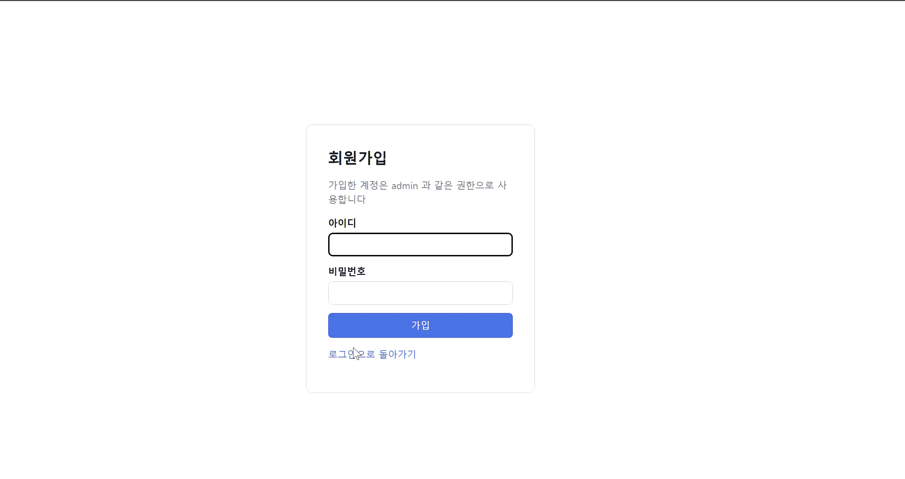

### 2) 이미 있는 아이디로는 회원 가입 불가

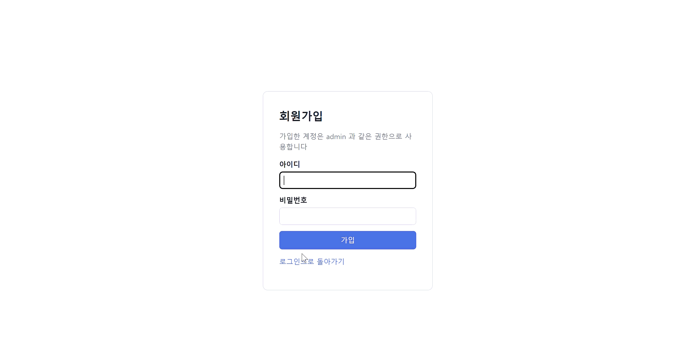

### 3) 아이디 제한 규칙
#### 영문, 숫자, _만 로만  3~20자
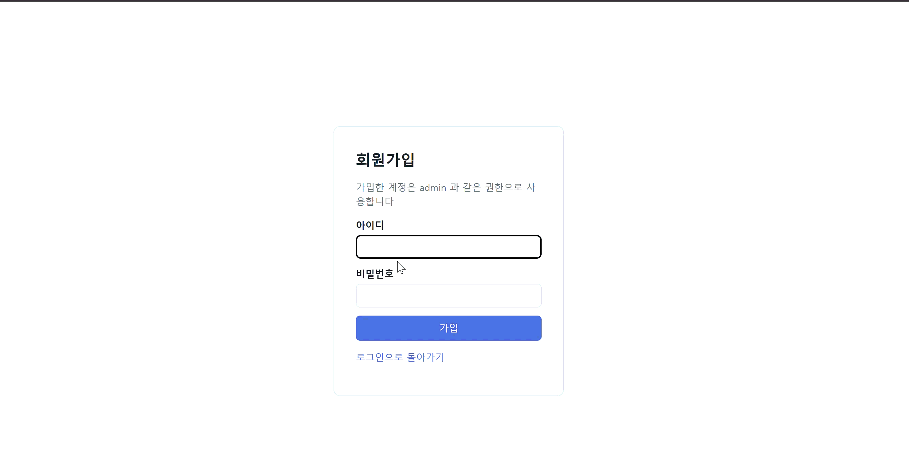

### 4) 비밀번호 제한
#### 4자 이상 64자 이하
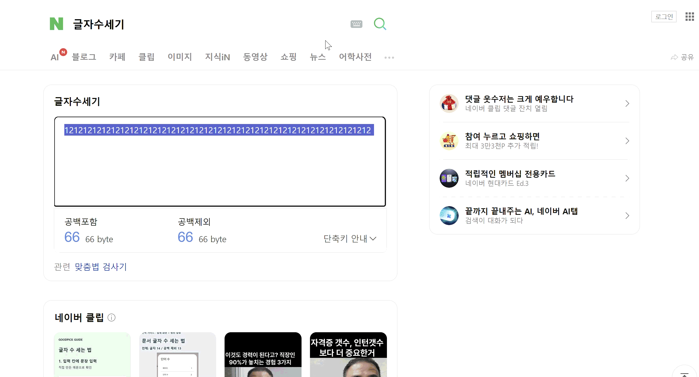

 

## 기능 2. 필요 납기일 기입 기능 추가

### 1) 납기일 체크박스 선택
#### 체크시에만 납기일 입력 박스 생성
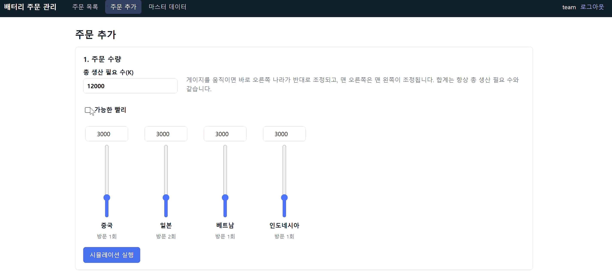

### 2) 납기일 입력 칸에서 5~50 범위로 고정
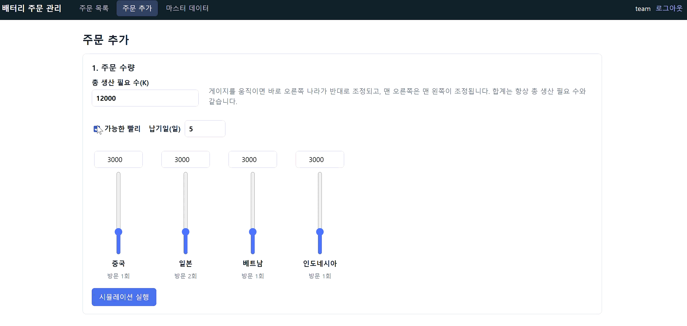

### 3) 희망 납기일 보다 큰 소요 일수 카드는 빨간색으로 표시

#### GIF 에는 빨간 배경이 잘 안나타나서 캡쳐본 첨부
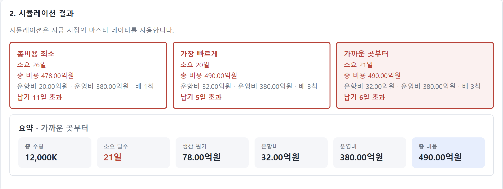

### 4) 희망납기가 소요일수 보다 작은 경우 alert 로 확인 후에 목록으로 저장

---

## 기능 3. 고객사 이름 입력 기능 추가
### 1) 고객사 이름 입력 가능
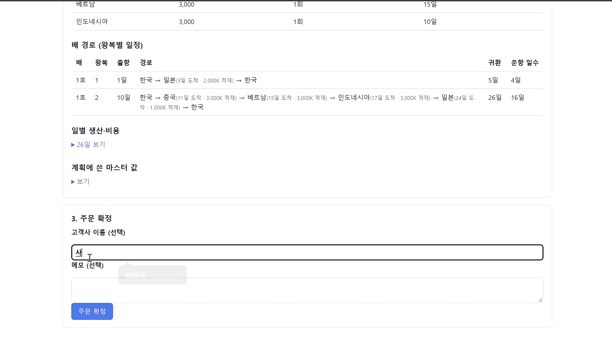

### 2) 고객사 수정 가능
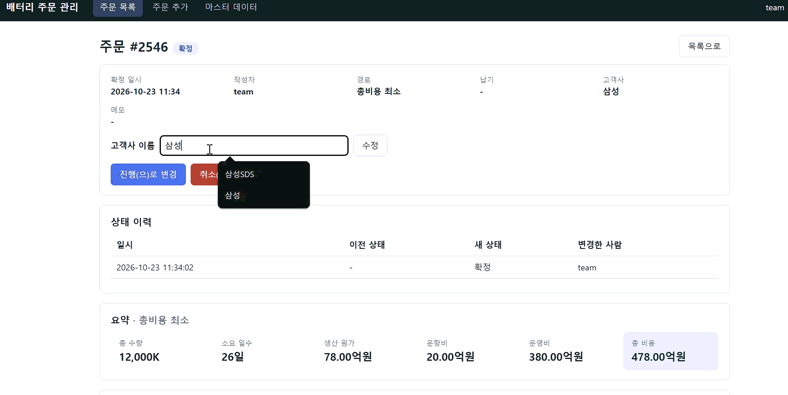

### 3) 고객사 공란이어도 주문 가능
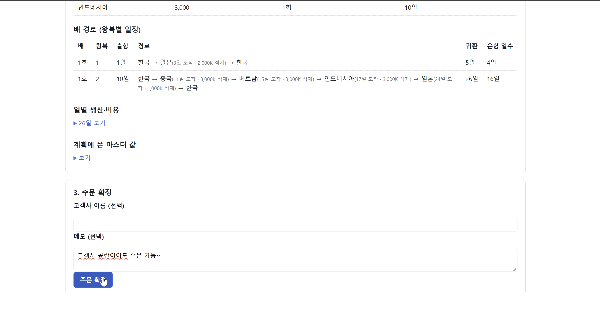

### 4) 완료, 취소 된 경우는 고객사 이름 수정 불가
#### 취소된 경우
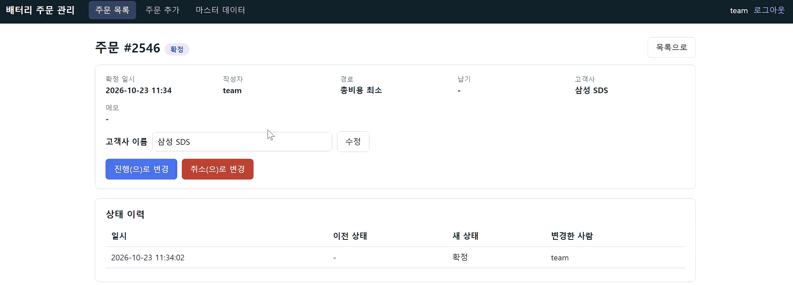

#### 완료된 경우
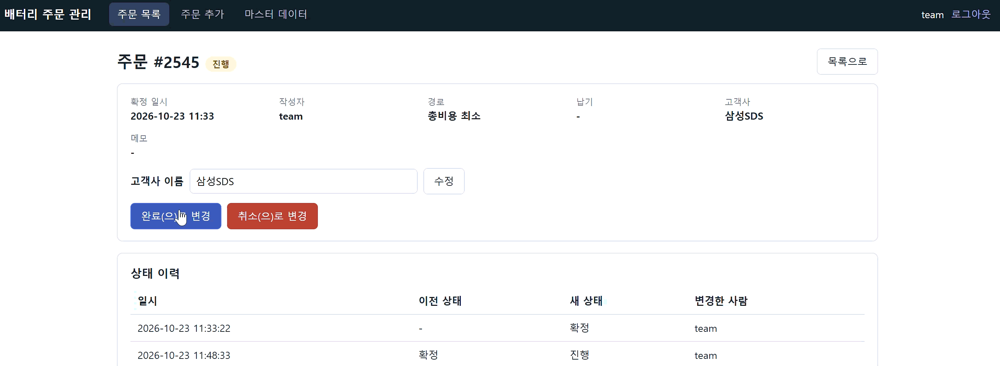

---
## 기능 4. 공장 운영비 추가

### 1) 공장 운영비 저장 가능 
#### (기본값 : 10억)
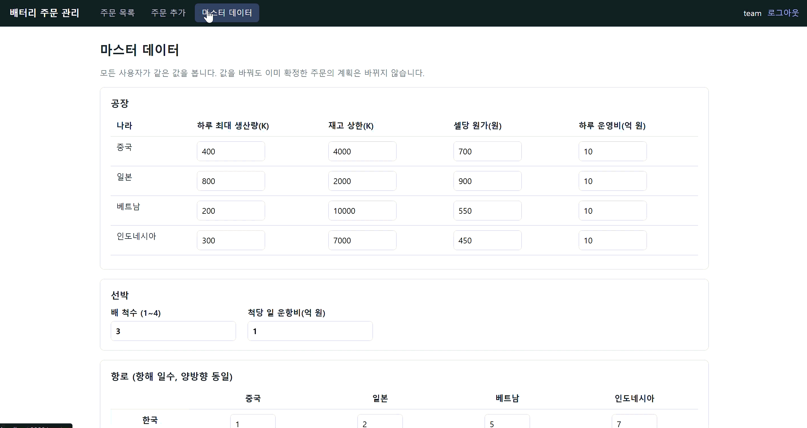

### 2) 메세지 카드에 공장 운영비도 금액에 포함

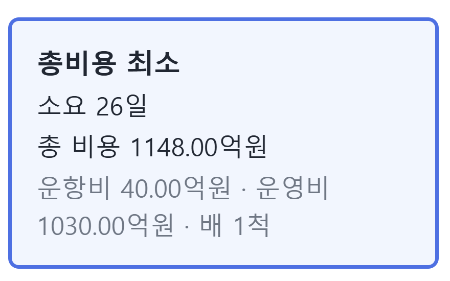

### 3) 운영비 반영 이후에는 운항비 최소에서 총비용 최소로 변경
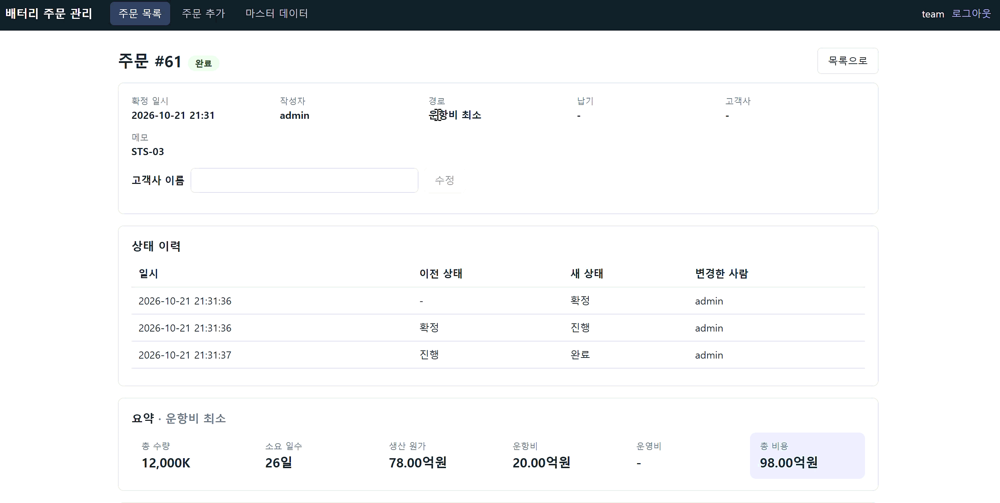

### 4) 하루 운영비 최대입력값 초과시 저장 불가
#### 입력값 1000억 초과 제한
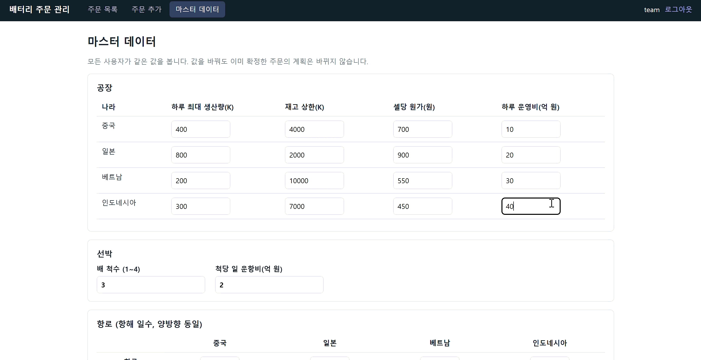

---

[← 이전: Loop 설계](02-loop.md) · [목차](README.md) · [다음: PR & 코드리뷰 →](04-review.md)