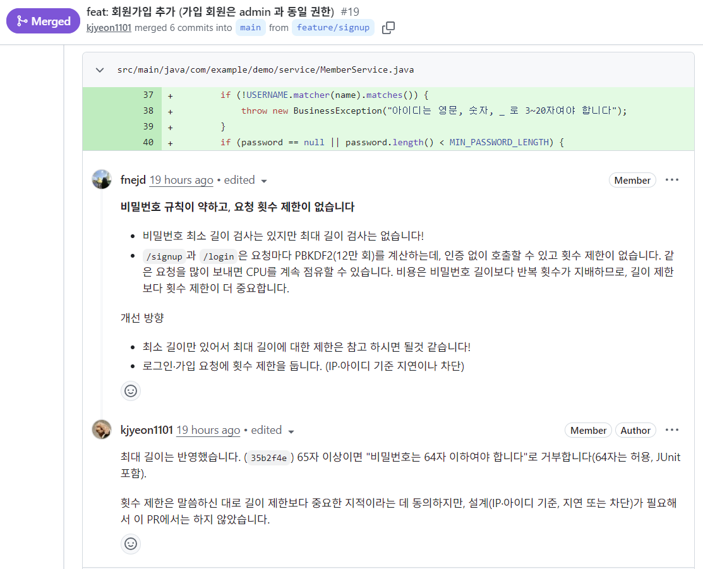
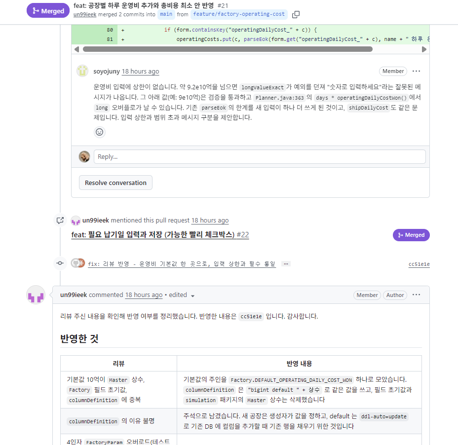

# 4. PR & 코드리뷰

Action과 Gate 규칙을 적용하여 PR & 코드 리뷰를 진행했습니다.

기능 추가를 담당한 팀원은 Action의 역할로서 기능을 개발하는 동시에 Code Smell을 추가했습니다.

다른 팀원은 Gate 역할로서 코드 리뷰 활동을 하며 Agent와 함께 개선안을 도출하는 프로세스로 진행했습니다.

미션별 PR 현황을 정리하고, Best Practice를 선정하여 좋았던 점을 적어 봅니다.

 

## 미션별 PR 현황

<!-- 각 미션은 Action과 Gate를 1명씩 담당합니다. 누가 무엇을 담당했는지 아래 표에 적으세요. -->

| 미션 | Action 담당자 | Gate 담당자 | PR 링크 | 리뷰 코멘트 수 | Commit 수 |
|---|---|---|---|:-:|:-:|
| 기능 1. 회원가입 기능  | 김재연 | 김도현 | https://github.com/sds-code-reviewer-26-8/battery-1-team/pull/19 | 6개 | 6개 |
| 기능 2. 필요 납기일 기입 기능 | 김도현 | 권웅기 | https://github.com/sds-code-reviewer-26-8/battery-1-team/pull/22 | 5개 | 20개 |
| 기능 3. 고객사 이름 입력 기능 | 김준영 | 김재연 | https://github.com/sds-code-reviewer-26-8/battery-1-team/pull/20 | 10개 | 8개 |
| 기능 4. 공장 운영비 추가 | 권웅기 | 김준영 | https://github.com/sds-code-reviewer-26-8/battery-1-team/pull/21 | 7개 | 2개 |

 

## Best Practice: 코드 리뷰

<!-- 코드 리뷰를 하며 효과를 본 Best Practice를 1개 이상 소개하세요. 쓰지 않는 블록은 지워도 됩니다. 예: PR 올리기 전 셀프 점검, 리뷰 체크리스트, 개선 제안 유형(리팩토링, 성능, TC 보강, 버그·보안)별 분류 -->

#### Best Practice 1

| 항목 | 내용 |
|---|---|
| 구현 내용 | <b>회원가입</b> 기능입니다. /signup 화면과 Member, MemberService를 추가했고 비밀번호는 PBKDF2 솔트 해시로 저장합니다. 가입 회원은 admin과 같은 권한으로 로그인합니다. |
| PR 링크 | https://github.com/sds-code-reviewer-26-8/battery-1-team/pull/19 |
| 문제 상황 | <b>인증·권한을 바꾸는 RED 영역 PR</b>이었고, 리뷰어가 두 가지를 지적했습니다.  - 예약어 admin만 대소문자를 무시하고 <b>일반 아이디의 중복 검사는 대소문자를 구분</b>해서, Alice와 alice처럼 비슷한 아이디로 사칭할 수 있었습니다.  - <b>비밀번호 최대 길이 제한</b>이 없었고, /signup과 /login에 <b>요청 횟수 제한</b>이 없어 PBKDF2(12만 회) 계산으로 CPU를 계속 쓰게 만들 수 있었습니다. |
| 적용한 방법 | 1. IgnoreCase 조회만 쓰면 DB unique 제약이 대소문자를 구분해 동시 가입을 못 막습니다. 그래서 <b>trim() 후 소문자로 정규화해 저장</b>하는 쪽을 택했습니다. 조회, 중복 검사, 예약어 비교도 같은 값을 씁니다. 2. <b>비밀번호는 65자부터 거부합니다(64자는 허용).</b> 3. 반영한 항목은 테스트로 고정했습니다. JUnit(Carol 가입 후 carol 400, CAROL 로그인 성공)과 E2E SIGNUP-06을 추가했습니다.  4. 반영하지 않은 항목은 이유를 남겼습니다. 횟수 제한은 IP·아이디 기준 설계가 필요해 이 PR에서는 하지 않았습니다. |
| 좋았던 점 | 1. 리뷰어가 "<b>문제, 위험, 개선 방향</b>" 순서로 코멘트를 남겼습니다. 각 코멘트에 개선 방향이 2가지씩 있어서 작성자가 바로 선택할 수 있었습니다. 그리고 작성자는 제안을 그대로 받지 않고 <b>근거를 대며 선택</b>했습니다. 2. 리뷰어가 "횟수 제한이 길이 제한보다 중요하다"고 <b>우선순위</b>까지 짚어 줘서, 무엇이 더 큰 위험인지 알 수 있었습니다. 3. 작성자가 IgnoreCase와 정규화의 차이를 설명한 덕분에 "왜 이 방식인가"가 PR에 남았습니다. 4. 하지 않은 일(횟수 제한)을 숨기지 않고 후속 과제로 분명히 남겼습니다. 5. PR 본문의 "리뷰 포인트"와 "확인하지 못한 것"에 리뷰어가 볼 곳을 미리 적어 둔 것도 효과가 컸습니다. 대소문자와 PBKDF2 설정이 실제로 리뷰 지적으로 이어졌습니다. |
| Evidence |  |

#### Best Practice 2

| 항목 | 내용 |
|---|---|
| 구현 내용 | <b>공장별 하루 운영비를 마스터에 추가</b>했습니다. 총 비용은 생산비 + 운항비 + 운영비로 계산하고, 첫 번째 안을 '운항비 최소'에서 '총비용 최소'로 바꿨습니다. |
| PR 링크 | https://github.com/sds-code-reviewer-26-8/battery-1-team/pull/21 |
| 문제 상황 | - 기본값 10억이 Master 상수, Factory 필드 초기값, columnDefinition에 따로 적혀 있어서, <b>하나만 고치면 서로 어긋날 수 있었습니다.</b> -<b>입력 상한이 없어</b> 큰 값에서 잘못된 오류 메시지가 나왔고 long 오버플로 위험이 있었습니다. |
| 적용한 방법 | 1. 기본값은 Factory.DEFAULT_OPERATING_DAILY_COST_WON <b>하나로 모았습니다</b>. 2. <b>입력 상한(1,000억 원)을 추가</b>했고, 상한·키 누락 거부 JUnit 2건을 넣었습니다. |
| 좋았던 점 | 1. 코드 위치를 짚은 인라인 코멘트로 근거를 제시했습니다. 리뷰어가 줄 단위로 <b>"왜 문제인지"와 "제안"을 같이 적었습니다</b>. 2. 인라인에 담기 어려운 API 계약, 문서·표시 불일치는 리뷰 본문에서 따로 물었습니다. "필수로 통일할지, 선택임을 명시할지 정해 달라"는 식으로 결정을 요청했습니다. 3. 작성자가 <b>리뷰 항목별 대응을 표로 정리</b>했습니다. 반영한 것과 반영하지 않은 것(사유 포함)을 나눠 한 번에 볼 수 있게 했습니다. 4. 반영하지 않은 항목(CLAUDE.md 표현, 같은 타입 연속 인자를 빌더로 바꾸는 일)도 영향 범위와 이유를 적어서, 후속 PR로 넘길 근거가 남았습니다. 5. 리뷰어가 수정 사항을 확인한 뒤 승인(APPROVED)해서 "정리하면 승인"이라는 흐름이 분명했습니다. |
| Evidence |  |

---

[← 이전: 기능 추가 미션 동작 영상](03-missions.md) · [목차](README.md) · [다음: 회고 →](05-retrospective.md)
